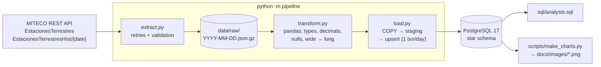
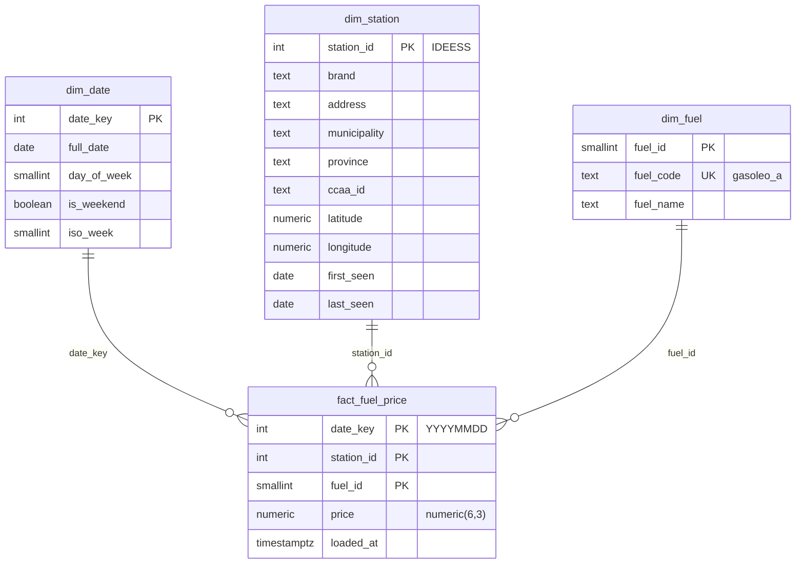
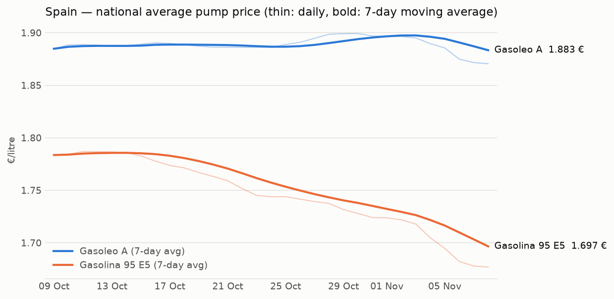
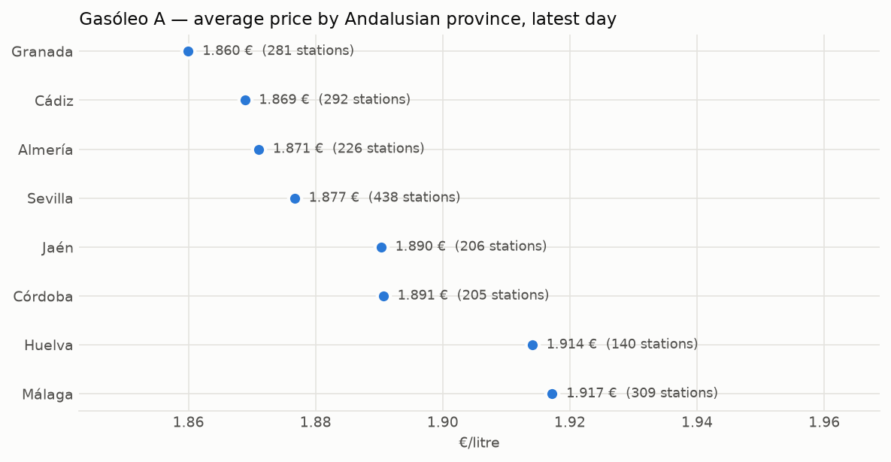

# fuel-prices-pipeline

> **Resumen en español.** Pipeline ETL que descarga a diario los precios de carburantes de las
> ~11.500 gasolineras de España desde la API pública del Ministerio, guarda el JSON crudo por
> fecha, lo limpia con pandas y lo carga de forma idempotente en un modelo en estrella en
> PostgreSQL (Docker). Incluye backfill de 30 días desde el endpoint histórico, consultas SQL
> de análisis con CTEs y funciones de ventana, gráficos, tests con pytest y CI con GitHub
> Actions. Notas de entrevista: [docs/INTERVIEW_NOTES.md](docs/INTERVIEW_NOTES.md).

A small, production-minded data engineering project: a daily batch ETL for Spanish fuel prices,
built with Python 3.12, pandas and PostgreSQL.

## The problem

The Spanish Ministry publishes the current pump price of every fuel at every station
(~11,500 stations, 23 fuels) as a ~12 MB JSON document that is overwritten every 30 minutes.
There is no ready-made history to query. This pipeline turns those snapshots into a clean,
queryable time series, so questions like *"where is diesel cheapest in Huelva today?"* or
*"how did prices move this month?"* become a SQL query.

## Architecture



1. **Extract** – downloads a snapshot with exponential-backoff retries (network errors, 429,
   5xx only), validates the envelope (`ResultadoConsulta == "OK"`) and only then stores the
   untouched payload, gzip-compressed (12 MB → 0.7 MB), written atomically.
2. **Raw layer** – one file per day. It is the source of truth: any day can be reprocessed
   without calling the API again. Historical days are cached; today is always re-downloaded.
3. **Transform** – the API returns everything as strings with a decimal comma (`"1,799"`) and
   empty strings for missing prices. Prices come as 23 columns; they are unpivoted to one row
   per station × fuel, dropping blanks (~43,000 rows per day instead of ~264,000 cells).
4. **Load** – `COPY` into temporary staging tables, then `INSERT … ON CONFLICT DO UPDATE`
   into the star schema, one transaction per day. Every run is recorded in `etl_run`.

## Data model



- **Grain:** one price per station, fuel and day, enforced by the composite primary key.
- **Long fact table:** no stored nulls, and a new fuel type needs no schema change.
- **`dim_station` is SCD type 1** with province and municipality denormalised (star, not
  snowflake). Out-of-order backfills cannot overwrite newer attributes
  (`ON CONFLICT … WHERE EXCLUDED.last_seen >= d.last_seen`).
- **`dim_date`** pre-computes weekday/weekend/ISO-week attributes for time analysis.
- **`numeric(6,3)`** instead of `float`: prices have exactly three decimals and must be exact.

## How to run it

Requirements: Python 3.12, Docker Desktop (the database container uses ~30 MB of RAM).

```bash
git clone https://github.com/e1000i0/fuel-prices-pipeline.git
cd fuel-prices-pipeline
python -m venv .venv
.venv\Scripts\activate            # Linux/macOS: source .venv/bin/activate
pip install -e ".[dev]"
copy .env.example .env            # then set POSTGRES_PASSWORD
docker compose up -d
python -m pipeline backfill --days 30   # last 30 days from the historical endpoint
python -m pipeline run                  # today's snapshot (safe to re-run)
python scripts/make_charts.py           # writes docs/images/*.png
docker exec -i fuel-postgres psql -U fuel -d fuel < sql/analysis.sql
```

Tests and lint (integration tests run when `TEST_DATABASE_URL` points to a database):

```bash
ruff check . && ruff format --check .
pytest
```

**Daily schedule (Windows):** `scripts/run_daily.cmd` is meant for Task Scheduler; the
registration command is in the file header. A scheduled GitHub Actions workflow is not used
because it cannot reach a local database.

## Results

State after the first run (8 Nov 2026): **31 days** loaded (30-day backfill + today),
**1,327,560** fact rows, **11,612** stations seen, 22 MB of raw files, 163 MB database.
A day loads in ~3 s; re-running it leaves the row count unchanged.



Over these 31 days 95 petrol fell from ~1.78 to ~1.68 €/l, while diesel stayed around
1.87–1.90 €/l.



Cheapest Gasóleo A in Huelva on 8 Nov 2026 (query 1 in [`sql/analysis.sql`](sql/analysis.sql);
`DENSE_RANK` keeps tied prices together):

| Rank | €/l | Brand | Municipality |
|---:|---:|---|---|
| 1 | 1.730 | FRESAFLOR, S.C.A. | San Bartolomé de la Torre |
| 2 | 1.735 | COBELLA | Lepe |
| 3 | 1.736 | COSTAOIL | Lucena del Puerto |
| 4 | 1.739 | SAT CONDADO | Rociana del Condado |
| 4 | 1.739 | VIRSUR | Rociana del Condado |

The SQL file also covers province ranking within Andalusia, day-over-day change per station
(`LAG`) with a 7-day moving average, and a weekday comparison (`dim_date`). With only four or
five weeks of data and a falling trend, the weekday result is not yet conclusive.

## Technical decisions

| Decision | Why |
|---|---|
| Keep the raw JSON per day | Reprocess any day after a bug fix without depending on the API. |
| Validate before saving raw | Never persist an error page or an empty payload as "data". |
| Retry only transient errors | A 404 will not fix itself; a 503 often does. |
| Long (unpivoted) fact table | Sparse data: 3–5 of 23 fuels per station. |
| Upsert + one transaction per day | Re-runs are idempotent and a day is never half-loaded. |
| Delete stale rows by `loaded_at < now()` | `now()` is fixed per transaction; this replaced an anti-join that took ~80 s/day with a PK-index scan (~3 s). |
| `COPY` into temp staging tables | The fastest bulk-load path in PostgreSQL. |
| psycopg 3 without an ORM | The SQL is the point of the project; nothing hides it. |
| Snapshot date from the API `Fecha` field | The data's own date, not the machine clock. |
| `RANGE` windows over dates | A 7-day moving average stays 7 calendar days even if a day is missing. |
| `127.0.0.1` instead of `localhost` | On Windows `localhost` tries IPv6 first and waited 10 s for a timeout. |

## What I would do next

- **Orchestration:** Airflow or Dagster for scheduling, retries, alerting and backfills.
- **dbt** for the SQL layer (staging → marts) with schema tests and documentation.
- **Data quality checks:** alert if the station count drops sharply or prices jump abnormally.
- **SCD type 2** on stations to track brand or address changes over time.
- **Cloud:** raw layer on S3/GCS, managed PostgreSQL, and a scheduled job that can reach both.
- **Dashboard:** Metabase or Superset on top of the star schema.

## Data source

Ministerio para la Transición Ecológica y el Reto Demográfico –
[Precios de carburantes REST service](https://sedeaplicaciones.minetur.gob.es/ServiciosRESTCarburantes/PreciosCarburantes/)
(public, no API key).
